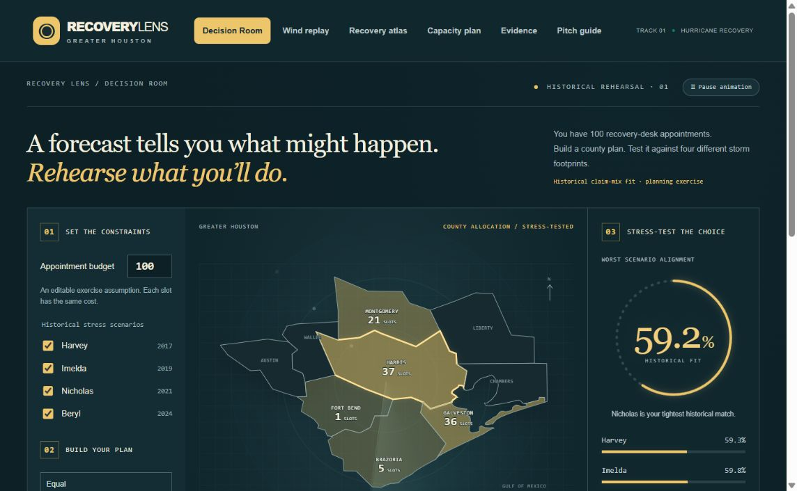

# Houston Recovery Lens

Built by **Siddharth Korampalli and Andrew Perlman**.

A Track 1 hurricane preparedness and recovery research demo for the Code[Coogs] AI Hackathon on October 23, 2026.

Recovery Lens opens with a Decision Room: allocate a fixed appointment budget, stress-test the county mix across historical storms, compare simple strategies, and export a decision receipt. A six-hour wind replay, historical recovery atlas, and assumed-request capacity planner support the decision workflow. It works offline in a single browser file and includes reproducible analysis and visible limitations.

## Start here

Open **OPEN_DEMO.html** here, choose **Download raw file**, and open the downloaded file. Download and extract **Houston_Recovery_Lens.zip** for the complete source, original data, fitted models, and runnable folder layout. Selected source files are also viewable here. No API key or plugin is needed.

1. **Decision Room:** edit a budget, choose historical scenarios, compare equal / pooled-historical / maximin allocation, and export a readable HTML receipt with its full calculation record. The default 100-slot exercise scores 41.8% for equal allocation and 59.2% for the rounded stress-tested mix on worst-scenario historical distributional overlap. This is scenario fit, not people helped or forecast accuracy.
2. **Wind replay:** select a weather window and county, move the cutoff hour, compare the model with persistence, and reveal the recorded following six hours.
3. **Recovery atlas:** compare observed building damage among eligible flood insurance claim records across four storms and five counties.
4. **Capacity plan:** edit assumed appointment requests, set available slots, review the allocation, and export the assumptions and plan together.
5. **Evidence:** inspect model selection, every evaluation window, the severe-peak weakness, and the earlier rejected financial model.
6. **Pitch guide:** follow the two-minute walkthrough and practice the answers.

The standalone HTML embeds all demo assets and data, including typography fallbacks. The multi-file demo may use an internet font when available. The GitHub repository stores the project privately; it is not a hosted app URL.

## The wind model

The target is the maximum gust in the next six hourly observations, t+1 through t+6. Thirteen inputs use only the current hour and preceding six hours. The pipeline separates whole storms and includes explicit timestamp checks.

- Fit on Harvey and Imelda: **2,160** windows.
- Choose the model using Nicholas: **660** windows.
- Replay Beryl as a development check: **900** windows.
- Check the frozen model on three separately downloaded 2026 weather windows: **4,260** windows.

The selected model is histogram gradient boosting. Candidates also include persistence, ridge regression, and residual gradient boosting. The candidate set and Nicholas selection rule were fixed before the extra weather was downloaded; the extra-window results were not used to tune the model. Beryl had already been inspected during earlier project work and is not described as an untouched final test.

| Evaluation | Model MAE | Persistence MAE | Relative reduction |
| --- | ---: | ---: | ---: |
| Nicholas selection | 4.65 mph | 4.83 mph | 3.8% |
| Beryl development replay | 5.61 mph | 6.50 mph | 13.8% |
| Additional 2026 windows combined | 3.53 mph | 3.68 mph | 3.9% |

[View the model evidence figure](Wind_Model_Evidence.png).

Gains are modest and retrospective. Overlapping windows and nearby county reference points are correlated, so row counts are not independent storm counts. No statistical significance claim is made.

**Severe Beryl peaks remain difficult:** the highest-gust tenth of windows had about 18.9 mph average error and substantial underestimation. When the current gust exceeds the training maximum, the demo abstains from the raw tree estimate and shows a labeled persistence fallback. Reported model scores remain the raw model scores. The fallback is a research guardrail, not a safety clearance, and it cannot detect every future extreme.

The shaded reference band uses the middle 80% of Nicholas signed residuals and offers no guaranteed coverage on another storm. It is not applied to the persistence fallback. Historical reanalysis reconstructs weather after the fact; this project does not demonstrate operational issue-time forecast performance.

## The recovery atlas

The supplied claims file contains **80,547** records. We select single-family occupancy codes 1 and 11, the four storms with matching organizer weather, known nonnegative assessed building damage, and building insurance coverage of $1–$250,000. The result contains **60,020 eligible records**.

Counties with weather coverage are Brazoria, Fort Bend, Galveston, Harris, and Montgomery. Austin, Chambers, Liberty, and Waller have supplied boundary polygons but lack matched claims and weather here. Zero eligible-claim combinations remain visible as insufficient data. Damage summaries with fewer than 20 eligible records are suppressed in the demo.

Joins use normalized storm names and five-character county FIPS, with many-to-one cardinality and record-count checks. Missing damage is excluded, never converted to zero. No unique claim or property ID was supplied, so repeat properties across storms cannot be ruled out.

The atlas shows assessed structural damage, separate from contents damage and insurance payout. Amounts are nominal dollars without inflation adjustment. Recorded totals do not cover every home, uninsured damage, or total community loss. A flood-zone claim share is not a flood probability.

An earlier financial severity model predicted zero for all Beryl claims and was rejected for planning use. Its source, model object, and failed results are preserved. It does not generate damage estimates in the atlas.

## The capacity scenario

Inputs are editable **assumed appointment requests**, not predicted need. The planner attempts a preferred county floor where feasible, then distributes remaining slots in proportion to unserved assumed requests using integer largest remainders. It conserves available slots and never assigns more appointments than assumed requests. If the floor cannot be met, it reports the shortfall.

An optional historical claim mix scales a storm's eligible claim shares into 200 assumed requests. This is labeled as a hypothetical scenario and can be overridden. Insurance records omit uninsured residents, so real outreach requires locally verified demand. Exports include capacity, floor, scenario source, assumed requests, assigned slots, and unserved requests. This is not emergency crew routing or a forecast of resource need.

## Files and reproduction

- `OPEN_DEMO.html` and `demo/`: standalone and multi-file interfaces.
- `analysis.ipynb`: **eight executed code cells** with explanations and outputs.
- `train_model.py`: claims cleaning, joins, rejected financial experiment, and historical summaries.
- `train_wind_model.py`: causal six-hour samples, whole-storm selection, frozen-model checks, and replay outputs.
- `fetch_external_weather.py`: reproducible additional ERA5 requests derived from the supplied 2026 tracks.
- `make_evidence_figure.py`: renders the comparison figure from saved metrics.
- `PRESENTATION_GUIDE.md`: two-minute pitch, click sequence, and judge questions.
- `JUDGES_BRIEF.md`: concise problem, method, measured results, and limits.
- `data_dictionary.md`: fields, joins, derived features, and scenario definitions.
- `data/`: original organizer extracts and a separate `external_validation/` folder.
- `results/`: quality audit, hashes, model objects, all metrics and predictions, and `Wind_Model_Evidence.png`.

To rerun, use Python 3.12 in this extracted project folder, install `requirements.txt`, then run `python train_model.py` and `python train_wind_model.py`. The added data is already included; the fetch script is optional when reproducing requests. Run `python make_evidence_figure.py` to regenerate the figure. In Colab, the notebook accepts the complete project ZIP when files are not already present.

Optional verification commands are `python verification/check_causality.py` and `node verification/check_capacity.cjs`. The second check uses only standard Node.js modules.

Only load serialized model objects from this project or another trusted source. The models are research artifacts, not operational decision tools.

## Sources and attribution

[Organizer folder](https://drive.google.com/drive/folders/1doFLc1xXvUDTBvoDg0wmebjGIaaCCy0a) and [Challenge 1 brief](https://docs.google.com/document/d/1n9FrZHastJOO1jy2f6X_PbYukTuAnrWgbJugyTK3lkw/edit), accessed October 23, 2026. The brief attributes claims to OpenFEMA NFIP, weather to Open-Meteo ERA5, tracks to NOAA IBTrACS, and boundaries to the U.S. Census Bureau. Original extracts are retained unchanged. Their upstream extraction procedures were not independently reproduced.

Additional weather: [Open-Meteo Historical Weather API](https://open-meteo.com/en/docs/historical-weather-api), Copernicus ERA5 reanalysis, CC BY 4.0. Request URLs explicitly set mph, inches, ERA5, and America/Chicago. Responses, source hashes, units, dates, and attribution are retained in `data/external_validation/`. Added-window names and dates come from the supplied track file; local impact and storm attribution were not independently verified.

AI coding assistance was used and is disclosed in the presentation. No user interviews, field validation, operational performance, or independent authorship are invented.

## Reproduce the Decision Room

Run `python optimize_rehearsal.py` after generating `results/demo_data.json`. This writes all 15 nonempty historical-scenario combinations to `results/decision_data.json`. The interface performs deterministic largest-remainder rounding for the chosen budget and recalculates scores. Run `node verification/check_decision.cjs` to check 315 policy/budget/scenario combinations. The optimization uses known historical mixes; it is descriptive decision analysis, not predictive validation.

## Visual motion

The Decision Room includes an animated score gauge, county-fill transitions, staggered entrance, and animated comparison bars. Use **Pause animation** to stop motion. Device reduced-motion preferences disable animated effects automatically. Calculations and exported receipts always use the actual final scores.

## Water-depth damage model

The **Predict damage** tab estimates a flooded home’s building damage with XGBoost from water depth, coverage, flood zone, county, and storm weather, and ranks zip codes by predicted damage if Harvey hit again. `predict_model.py` reproduces the experiment and saves the fitted model, evaluation metrics and interpolation grid. `build_demo.py` rebuilds the standalone HTML from `demo/`. Install the pinned requirements and run `python predict_model.py`, then `python build_demo.py` from the complete extracted project.

The integrated rerun retained **54,000 claim records**. Random-record holdout MAE was **$45,440** versus **$56,263** for its training-median baseline (19.2% lower). Beryl excluded from fitting had MAE **$21,703**, versus **$47,623** for the older-storm median and **$24,986** for always zero; R² was **−0.374**. Results differ slightly across execution environments. These are development checks; Beryl was already inspected during project development, and random claim records are not verified distinct homes. The final interactive grid is refitted on all 54,000 records.

The claim field does not state its depth unit, so the model keeps recorded depths of 0–10, where most values look like feet. The model uses each storm’s recorded weather and depth, so it estimates damage once a storm has hit rather than forecasting before landfall. Zip totals cover homes in the claim records, not every home. The estimator suppresses county/storm/zone cohorts with fewer than 50 retained depth-coded records. Numeric inputs clamp to the exported grid, show the value used, and retain the last valid estimate for blank input. Interpolated values blend four neighboring grid predictions.
